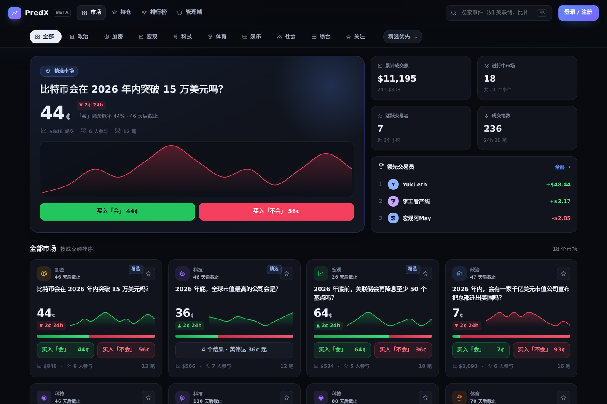
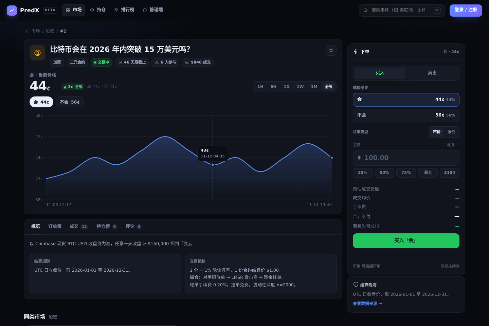
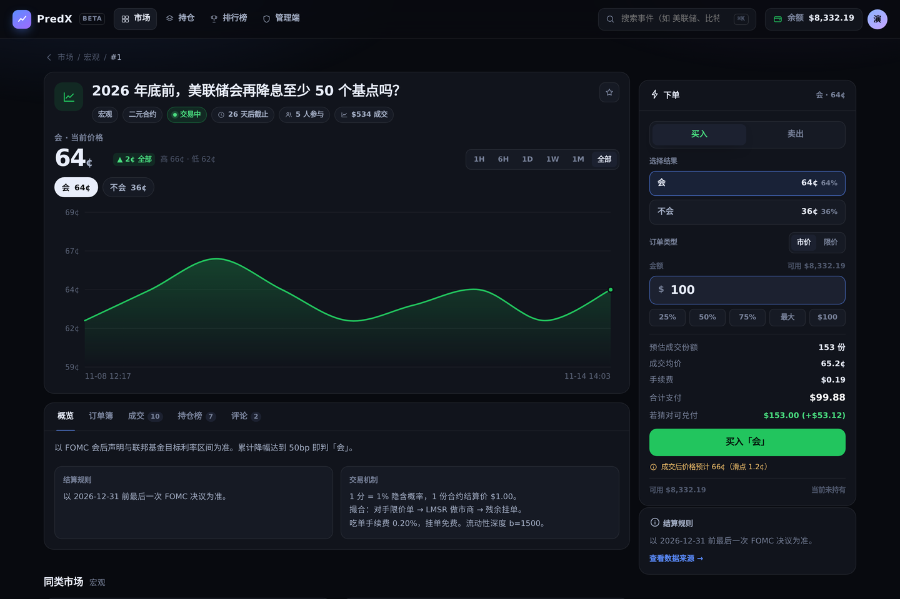
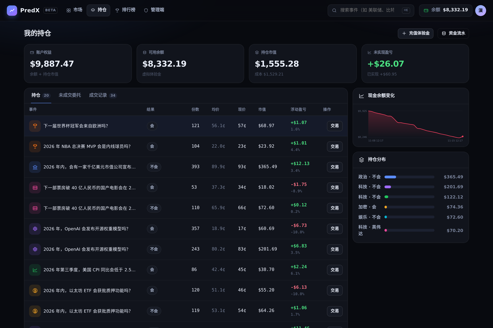

<div align="center">

# PredX · 事件合约交易所

**一个零依赖、零构建的中文预测市场全栈演示系统**
Python 标准库 + SQLite + 原生 JS ｜ LMSR 做市 + 限价簿混合撮合 ｜ 52 项测试全绿

[](https://github.com/WL-2598/predx/actions/workflows/test.yml)


</div>


> 用价格表达你对未来的判断。价格即概率，1 份合约结算价 $1.00。
> 形态对标 Polymarket：分类浏览事件 → 买卖 Yes/No（或多结果）→ 实时盘口与价格曲线 → 持仓盈亏 → 结算兑付 → 排行榜。

**一句话定位**：可私有化部署的「预测市场」全栈演示系统 —— 零第三方依赖（Python 标准库 + SQLite + 原生 JS），
`python3 run.py` 就能跑出一个带撮合引擎、做市商、持仓账本、管理后台和深色交易终端的完整站点。

> ⚠️ **合规声明**：本项目是**技术演示**。全部资金为虚拟体验金，不接入任何真实支付通道、不涉及法币出入金、
> 不发行任何代币或积分（不可转让、不可交易、无货币价值）。不面向真实资金博彩业务，
> 仅用于研究、教学与产品原型验证。详见 [DELIVERY.md](DELIVERY.md#合规与风险声明)。

---

## 快速开始

```bash
git clone https://github.com/WL-2598/predx.git && cd predx
python3 run.py                    # 首次启动会自动建库 + 灌演示数据
# → http://localhost:8100
```

> 只想看代码不想跑？`data/` 已被 `.gitignore` 忽略，首次运行会用 `app/seed.py` 重新生成
> 21 个市场、236 笔成交、16 条评论，几秒钟就好。

其他入口：

```bash
python3 run.py --init-only        # 只初始化数据，不起服务
python3 run.py --port 9000        # 换端口
make test                         # 52 项测试
make smoke                        # 服务运行时打一遍 HTTP 冒烟
python3 manage.py stats           # 平台概览 / markets / resolve / deposit / sql …
```

**环境要求**：Python ≥ 3.10。无 pip 依赖（`requirements.txt` 为空是有意为之）。

### 演示账号

| 账号 | 密码 | 角色 | 说明 |
|---|---|---|---|
| `demo@predx.io` | `demo1234` | 交易员 | 已持有 21 个持仓，余额 $8,332.19 |
| `admin@predx.io` | `admin1234` | 管理员 | 可上架 / 停盘 / 结算市场、冻结用户、看审计日志 |
| `creator@predx.io` | `creator1234` | 市场创建者 | 只能上架市场，不能结算 |
| 6 个做市机器人 | `bot12345678` | 交易员 | 种子数据里制造真实成交与价格曲线 |

也可以在页面上注册新账号：**注册即送 $10,000 虚拟体验金**。

---

## 界面速览

| 首页（Hero + 指标 + 卡片网格） | 市场详情（区间切换 + 十字光标行情图） |
|---|---|
|  |  |

| 交易面板（实时报价） | 持仓（KPI + 现金曲线 + 分布） |
|---|---|
|  |  |

首页 / 详情 / 订单簿 / 交易 / 持仓 / 排行榜 / 评论 / 管理端 / 移动端 —— 共 11 张，
见 [`docs/UI-GUIDE.md`](docs/UI-GUIDE.md)。

## 功能地图

**浏览**
- 18 个进行中市场（含 3 个多结果合约）+ 3 个已结算市场，覆盖 8 大分类
- 首页：精选市场 Hero（大字概率 + 平滑走势 + 一键买入）、平台指标、领先交易员 Top3、三步说明
- 卡片式网格：分类 SVG 图标、大号概率、24h 涨跌、平滑迷你走势、概率分割条、参与人数与成交笔数、关注星标
- 排序：精选优先 / 最新 / 即将截止 / 最活跃；8 个分类 Tab + 「关注」筛选；关键词搜索（`⌘K` 聚焦）
- 详情页：**1H/6H/1D/1W/1M/全部** 区间切换的行情图（带十字光标与悬浮读数）、规则说明、订单簿、最近成交、持仓大户、评论、同类市场推荐

**交易**
- 买入 / 卖出 × 市价 / 限价，二元与多结果合约通用；25%/50%/75%/最大 快捷比例
- 下单前**实时报价**：预估成交份额、均价、手续费、合计支付、若猜对可兑付（含净收益）、
  成交后价格与滑点提示、深度不足时提示「当前最多可成交多少」
- 订单簿阶梯：真实挂单 + LMSR 做市商合成深度（带深度条），显示买一/卖一与价差
- 未成交部分自动挂单，随时可在持仓页撤单（撤单自动解冻）

**账户**
- 4 个 KPI（权益 / 余额 / 持仓市值 / 未实现盈亏）+ 持仓表（含百分比盈亏）+ 委托与成交页签
- **现金余额曲线**（按资金流水）+ 持仓分布条
- 资金流水弹窗（体验金 / 买入 / 卖出 / 结算兑付 / 撤单退款）
- 排行榜：前三领奖台 + 全表（权益、盈亏、收益率进度条、未实现、持仓数）

**管理端**
- 上架市场：问题、2–8 个结果、分类、emoji、初始概率、流动性深度 b、截止时间、规则与来源 URL
- 停盘 / 复牌 / 结算（结算即向赢家每份兑付 $1.00，其余归零，撤销全部未成交挂单）
- 用户冻结 / 解冻、平台统计（成交额、手续费收入、分类分布、近 14 日成交）、审计日志

---

## 交易机制（三句话说清）

1. **价格单位是「分」**：1–99 分 = 1%–99% 的隐含概率；1 份合约结算价 100 分（$1.00）。
2. **撮合顺序**：① 对手方限价簿（价优 → 时间优）→ ② LMSR 做市商吃单 → ③ 剩余部分挂单冻结。
3. **做市商是数学公式**：成本函数 `C(q) = b · ln Σ exp(qᵢ/b)`，价格是 softmax；买入向上取整、卖出向下取整，
   保证「买完立刻按原价卖回」不会凭空赚钱。手续费只向吃单方收 0.20%（最低 1 分），挂单免费。

想深入看数学推导、并发与一致性保证、以及为什么这么设计 → [ARCHITECTURE.md](ARCHITECTURE.md)。

---

## HTTP API 速查

所有需要登录的接口带 `Authorization: Bearer <token>`（或 `X-API-Key: <key>`）。金额单位为**分**。

| 方法 | 路径 | 说明 |
|---|---|---|
| POST | `/api/auth/register` | 注册（送体验金） |
| POST | `/api/auth/login` | 登录，返回 JWT |
| GET | `/api/auth/me` | 当前用户 + 持仓/挂单计数 |
| GET | `/api/markets` | 市场列表（`category` / `status` / `sort=hot\|new\|closing\|trending` / `q` / `limit`） |
| GET | `/api/markets/{id}` · `/api/m/{slug}` | 市场详情（含 `books` 盘口、`recent_trades`、`top_holders`） |
| GET | `/api/markets/{id}/history?outcome_id=&range=1h\|6h\|1d\|1w\|1m\|all` | 价格曲线（按区间过滤 + 重采样，返回 stats） |
| GET | `/api/markets/{id}/book?outcome_id=` | 单结果盘口 |
| POST | `/api/markets/{id}/quote` | 下单前报价（`qty` 或 `amount_cents` + `price_cents` + `max_slippage_bps`） |
| POST | `/api/markets/{id}/orders` | 下单（`side=buy\|sell`、`order_type=market\|limit`） |
| DELETE | `/api/orders/{id}` | 撤单 |
| GET | `/api/orders` | 我的委托（`status=open\|all`） |
| GET | `/api/my/trades` | 我的成交 |
| GET | `/api/markets/categories` · `/api/markets/stats` | 分类统计 / 平台统计（含 24h 成交额、活跃交易者） |
| GET | `/api/leaderboard` | 排行榜 |
| GET | `/api/portfolio` | 持仓 + 汇总 + 未成交委托 |
| GET | `/api/wallet/ledger` · POST `/api/wallet/deposit` | 资金流水 / 充值体验金 |
| GET/POST | `/api/markets/{id}/comments` | 评论列表 / 发表评论 |
| POST | `/api/markets/{id}/watch` · GET `/api/watchlist` | 关注 / 我的关注 |
| POST | `/api/admin/markets` | 上架市场（管理员 / 创建者） |
| POST | `/api/admin/markets/{id}/close` · `/reopen` · `/resolve` | 停盘 / 复牌 / 结算 |
| GET | `/api/admin/users` · POST `/api/admin/users/{id}/status` | 用户列表 / 冻结 |
| GET | `/api/admin/stats` · `/api/admin/audit` | 平台/财务统计、审计日志 |

错误统一返回 `{"error": {"code": "...", "message": "..."}}`。限流：`/api/auth/*` 每 IP 每分钟 20 次，其他 300 次。

**curl 示例**

```bash
TOKEN=$(curl -s -X POST localhost:8100/api/auth/login -H 'Content-Type: application/json' \
  -d '{"email":"demo@predx.io","password":"demo1234"}' | python3 -c 'import sys,json;print(json.load(sys.stdin)["token"])')

# 报价：花 $200 买第 1 个结果
curl -s -X POST localhost:8100/api/markets/1/quote -H 'Content-Type: application/json' \
  -d '{"outcome_id":1,"side":"buy","amount_cents":20000}'

# 下单（市价买入）
curl -s -X POST localhost:8100/api/markets/1/orders -H "Authorization: Bearer $TOKEN" \
  -H 'Content-Type: application/json' -d '{"outcome_id":1,"side":"buy","order_type":"market","amount_cents":20000}'
```

---

## 目录结构

```
predx/
├── run.py                     # 入口：--init-only / --host / --port
├── manage.py                  # 运维 CLI：init / reset / stats / markets / resolve / deposit / sql
├── Makefile                   # make init / run / test / smoke / reset / backup
├── requirements.txt           # 空（零依赖声明）
├── app/
│   ├── config.py              # 全部参数可用 PX_* 环境变量覆盖
│   ├── schema.sql             # 12 张表 + 索引
│   ├── db.py                  # 连接/事务/迁移/仓储工具
│   ├── http.py                # 路由器、鉴权、静态资源、SPA 回退、统一错误
│   ├── security.py            # JWT（HMAC-SHA256）、PBKDF2 口令、API Key、限流
│   ├── main.py                # 装配层
│   ├── seed.py                # 演示数据（真实走引擎成交 175 笔）
│   ├── services/
│   │   ├── lmsr.py            # 成本函数、价格、数量换算
│   │   ├── engine.py          # 撮合、下单、撤单、结算、盘口
│   │   ├── markets.py         # 列表/详情/历史/持仓/排行榜/平台统计
│   │   └── audit.py           # 审计日志
│   ├── api/                   # auth / markets / trading / portfolio / social / admin
│   └── static/                # index.html + app.js + styles.css（零构建 SPA）
├── tests/                     # 52 项：定价、接口、撮合、结算、管理端
└── data/predx.db              # SQLite（WAL）
```

## 配置项（环境变量）

| 变量 | 默认 | 含义 |
|---|---|---|
| `PX_PORT` | `8100` | 监听端口 |
| `PX_HOST` | `0.0.0.0` | 监听地址 |
| `PX_DB_PATH` | `data/predx.db` | 数据库路径 |
| `PX_SECRET_KEY` | dev 占位值 | JWT 签名密钥（**生产必须更换**） |
| `PX_TAKER_FEE_BPS` | `20` | 吃单手续费（0.20%） |
| `PX_LMSR_B` | `1200` | 默认流动性深度（越大价格越稳） |
| `PX_SIGNUP_BONUS_CENTS` | `1000000` | 注册赠送体验金（$10,000） |
| `PX_ALLOW_REGISTRATION` | `1` | 是否开放自助注册 |
| `PX_RATE_LIMIT_API` | `300` | 每 IP 每分钟接口请求上限 |

完整列表见 `app/config.py`。

---

## 测试

```bash
make test        # 52 passed
python3 manage.py verify   # 系统级不变量对账（价格合计 / 持仓守恒 / 余额 / 流水）
```

| 文件 | 覆盖 |
|---|---|
| `tests/test_lmsr.py` | 成本函数单调性、价格求和恒为 100、买卖对称性、`max_buy_qty` |
| `tests/test_api.py` | 注册/登录/鉴权、市场列表与筛选、详情与盘口（买一<中间价<卖一）、曲线、分类、统计、排行榜 |
| `tests/test_trading.py` | 市价/限价买入卖出、余额与份额校验、挂单冻结与撤单退款、持仓成本、结算兑付、不变量校验 |
| `tests/test_admin.py` | 上架/停盘/复牌/结算、权限隔离、冻结用户、审计日志、评论 |

---

## 已知边界（诚实版）

- **单机 SQLite**：写入靠 `BEGIN IMMEDIATE` 串行化，适合演示与中小规模（可支撑数百并发读、数十笔/秒写）。
  真要上规模需要换 PostgreSQL 并把撮合改成单线程内存匹配器。
- **做市商是 LMSR 而不是真实挂单簿**：价格平滑但深度固定为 `MAKER_LEVELS × MAKER_SIZE`，不适合超大单。
- **行情点是「事件驱动」的**：只有成交才生成价格点，长时间无成交则曲线是平的。生产环境需要定时采样。
- **报价偏保守**：深度不足时 `quote` 会给出「最多可成交」，实际成交可能略多于此（不会超预算）。
- **无 KYC / 无风控 / 无出入金**：这是演示系统，不做真实资金业务，因此刻意不实现这些。

## 合规与风险声明

本项目为技术演示，不构成任何投资建议或要约；不接入真实支付、不发行代币、不提供法币兑换。
详见 [DELIVERY.md](DELIVERY.md#合规与风险声明)。
