# PredX 界面与设计说明（v1.1）

> 这一版的重点是**界面**：把「能用」的演示站点做成「看起来像真的交易终端」。
> 下面所有截图都是 `PLAYWRIGHT + Chromium` 真实渲染后自动截的（不是 PS 的），
> 对应文件在 `docs/screens/`。

---

## 1. 设计目标与对标

| 维度 | 对标（Polymarket / 主流交易终端） | PredX v1.1 的做法 |
|---|---|---|
| 首屏信息密度 | 精选大图 + 数据条 + 卡片网格 | 精选市场 Hero（含走势与一键买入）+ 4 个平台指标 + 领先交易员 |
| 卡片 | 概率大字、涨跌、微型走势、Yes/No 价 | 相同，另加「参与人数 / 成交笔数 / 关注星标 / 精选标」 |
| 详情页 | 大价格 + 区间切换的行情图 + 右侧交易面板 | 相同，行情图带**十字光标与悬浮读数**，面板带**实时报价** |
| 盘口 | 买卖双列 + 深度条 | 双列阶梯 + 深度条 + 价差行 + 做市商最大敞口 |
| 账户 | 权益/盈亏/持仓表 | 4 个 KPI + 持仓表 + **现金余额曲线** + 持仓分布条 |
| 排行榜 | 前三领奖台 + 全表 | 相同 |
| 后台 | 数据看板 + 市场/用户管理 | KPI + 14 日成交柱状图 + 分类分布 + 三页签管理 |

---

## 2. 视觉系统

**颜色**

| 语义 | 值 | 用途 |
|---|---|---|
| 背景 | `#080a0f` | 页面底色（顶部有两道很淡的品牌光晕） |
| 面板 | `#11141c` / `#161a24` | 卡片、输入、次级块 |
| 描边 | `rgba(255,255,255,.07)` | 全局 1px 细边，靠边而非靠阴影分层 |
| 主品牌 | `#5b8cff → #a06bff` 渐变 | 主按钮、选中态、光晕 |
| 会 / Yes | `#22c55e` | 买「会」按钮、上涨、正盈亏 |
| 不会 / No | `#f43f5e` | 买「不会」、下跌、负盈亏 |
| 文本三级 | `#e9eefb / #a5b0c7 / #78829a` | 标题 / 正文 / 说明 |

**字体与数字**：系统字体栈（不引外链字体），全局 `font-variant-numeric: tabular-nums`，
价格、金额、份数在任何位置都对齐；等宽字体只用于时间戳。

**图标**：全部是内联 SVG（`ICONS` 常量 + `icon(name)`），按分类着色：
政治=蓝、加密=琥珀、宏观=绿、科技=紫、体育=橙、娱乐=粉、社会=青、综合=灰。
**不使用 emoji 作为功能图标**——emoji 在无彩色字体的容器/内网环境会退化成方框（这正是 v1.0 的问题）。

**圆角/间距**：卡片 16px、控件 10–12px、胶囊 999px；间距统一为 4 的倍数。

---

## 3. 页面清单

### 3.1 首页（`#/markets`）

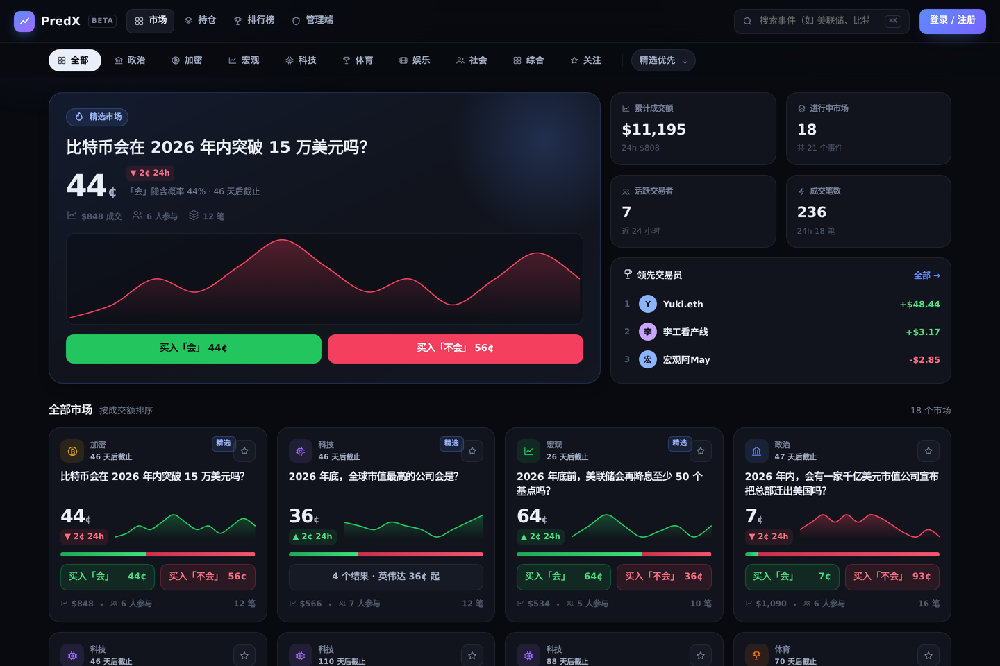

- 顶部：品牌 + 主导航（市场/持仓/排行榜/管理端）+ 搜索（`⌘K` / `/` 聚焦）+ 余额胶囊 + 头像菜单
- 分类条（吸顶）：8 个分类带图标与在售数量 + 「关注」筛选 + 排序下拉
- Hero：精选市场的题目、大字概率、24h 涨跌、**平滑走势图**、成交/参与人数、双色一键买入
- 右侧：累计成交额（含 24h）、进行中市场、活跃交易者、成交笔数 + 领先交易员 Top3
- 市场网格：4 列自适应（`auto-fill minmax(310px,1fr)`）
- 底部：三步说明「PredX 怎么运作」+ 合规页脚

### 3.2 市场详情（`#/market/:id`）

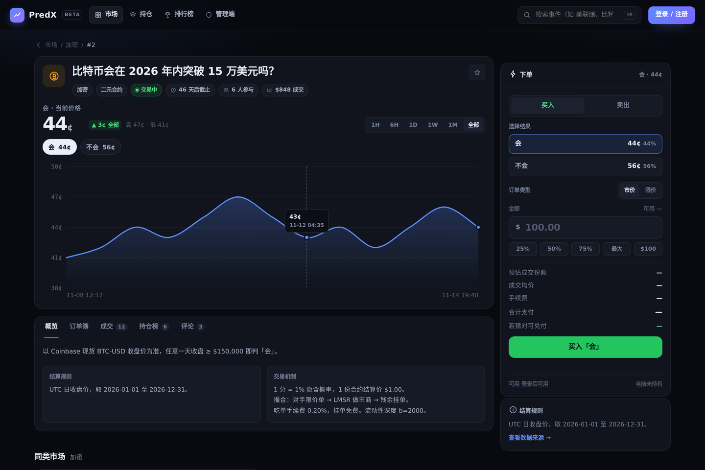

- 标题区：分类图标、题目、状态/截止/参与人数/成交额胶囊、关注星标
- 行情区：大字价格 + 区间涨跌 + **1H/6H/1D/1W/1M/全部** 切换 + 结果切换胶囊 + 十字光标行情图
- 下方页签：概览（说明 + 结算规则 + 交易机制）/ 订单簿 / 成交 / 持仓榜 / 评论
- 底部：同类市场推荐（同分类 3 个），可直接下单

> 行情图是手写 SVG：`smoothPath()` 用 Catmull-Rom 转三次贝塞尔，
> 鼠标移动时取最近数据点画虚线 + 圆点 + 悬浮读数（截图里 62¢ / 11-11 13:04 就是它）。

### 3.3 订单簿

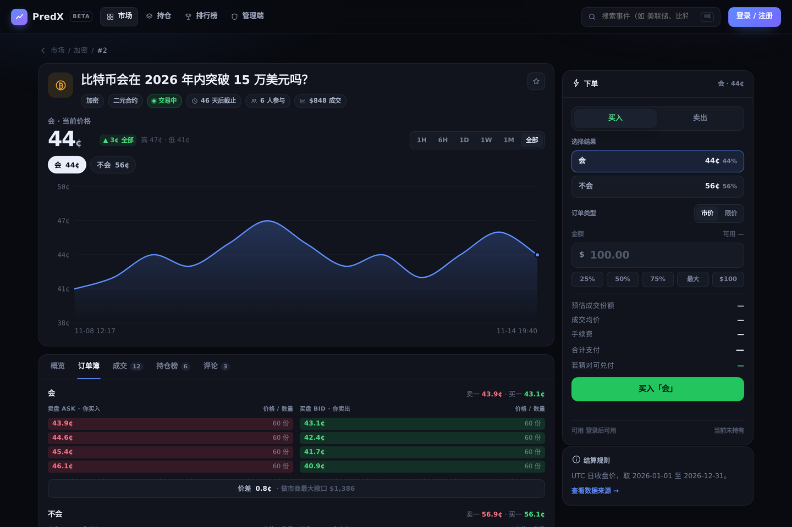

左列卖盘（你买入的对手方）、右列买盘（你卖出的对手方），每档带**深度条**，
用户挂单带虚线描边（`user` 样式），中间一行显示价差与做市商最大敞口。
数据来自 `GET /api/markets/{id}/book` 与详情里的 `books` 字段：真实挂单 + LMSR 合成深度。

### 3.4 交易面板（截图：输入 $100 后的实时报价）

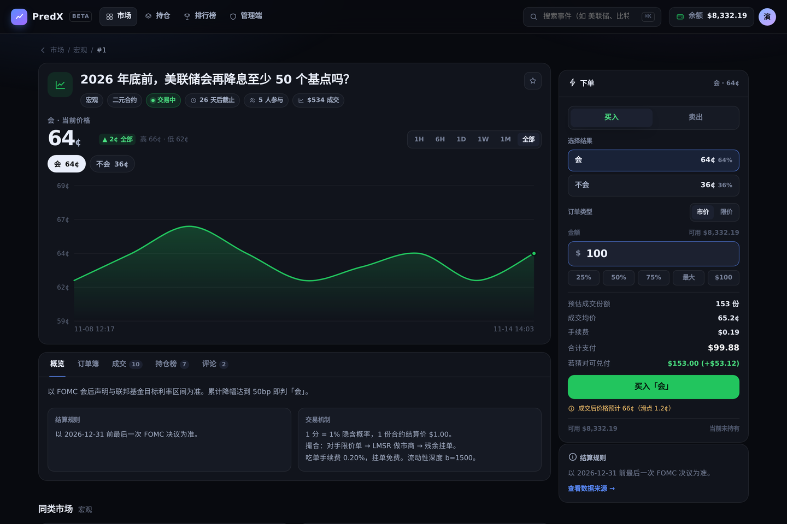

1. 买入 / 卖出分段控件（选中时文字变绿/红）
2. 结果选择（二元两个按钮、多结果列出全部）
3. 订单类型：市价 / 限价（限价出现 ±1 调整器）
4. 金额或份额输入 + `25% / 50% / 75% / 最大 / $100` 快捷
5. **实时报价**：预估份额、成交均价、手续费、合计支付、若猜对可兑付（含净收益）
6. 提示行：滑点提示 / 「当前深度最多成交 X 份」/ 报错信息
7. 底部：可用余额 + 当前持仓与可卖份额

输入后会防抖 250ms 调用 `POST /api/markets/{id}/quote`，报价与真实下单使用**同一套参数**
（含 5% 价格保护），所以看到的成交价和实际成交价一致。

### 3.5 持仓（`#/portfolio`）

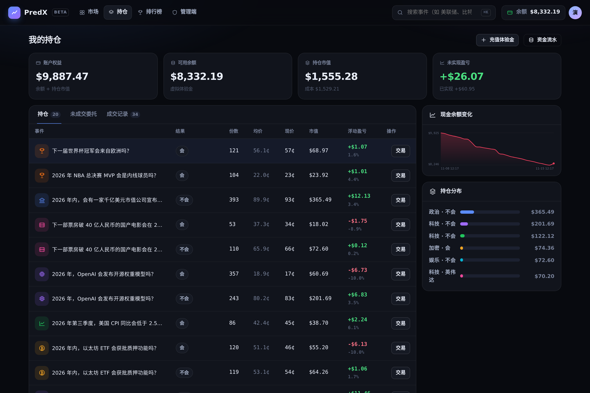

- 4 个 KPI：账户权益 / 可用余额 / 持仓市值 / 未实现盈亏（附已实现）
- 页签：持仓 / 未成交委托（可撤单）/ 成交记录
- 持仓表：分类图标、结果、份数（含挂单冻结）、均价、现价、市值、浮动盈亏（含百分比）、交易入口
- 右栏：**现金余额曲线**（来自资金流水）+ 持仓分布条（按市值）

### 3.6 排行榜（`#/leaderboard`）

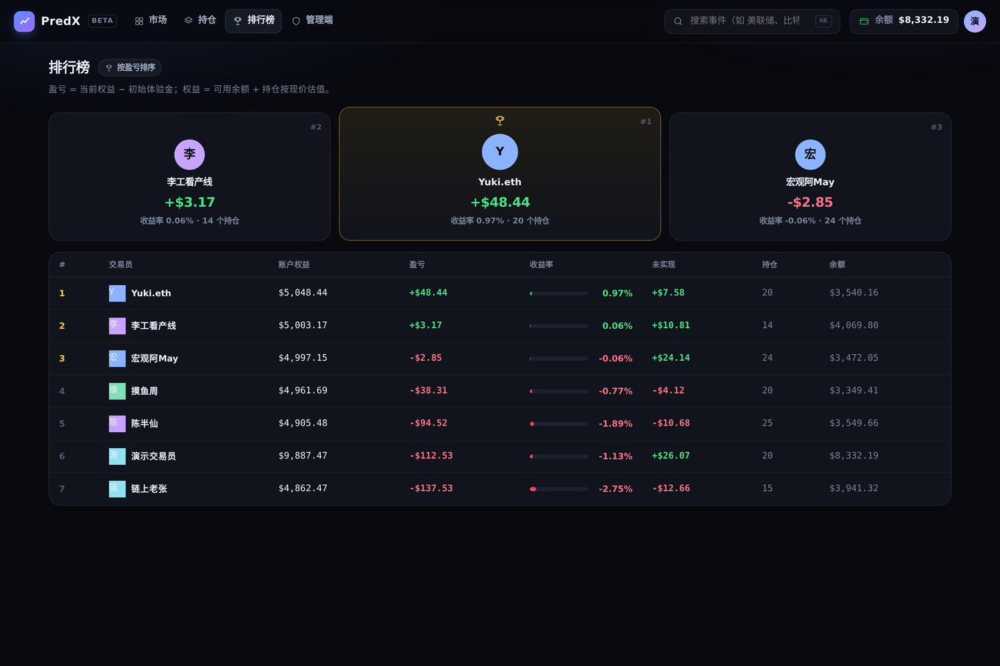

前三名领奖台（第一名描金边 + 奖杯），下表含权益、盈亏、收益率进度条、未实现、持仓数、余额。

### 3.7 登录 / 注册（`#/auth`）

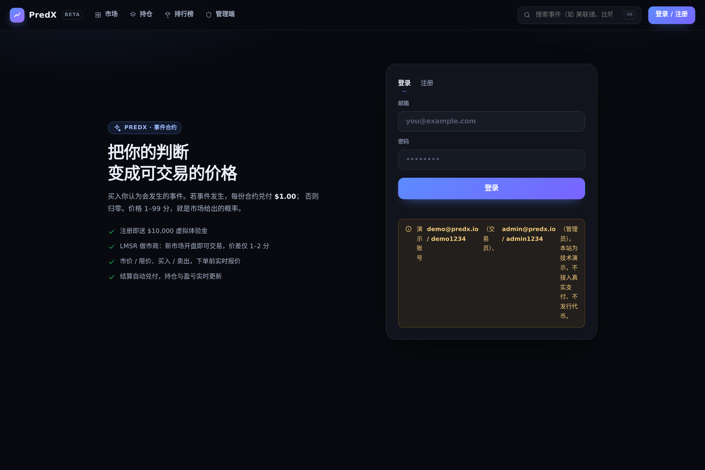

左侧讲清产品（价格即概率、LMSR 做市、结算兑付），右侧表单 + 演示账号提示。
回车即提交，登录后回到市场页并弹出欢迎 toast。

### 3.8 评论

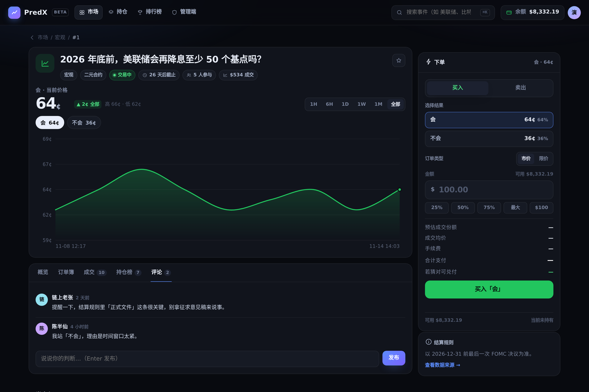

头像用昵称首字 + 稳定配色的圆形；相对时间（「3 天前」）；登录后可在页签内直接发布。

### 3.9 管理端（`#/admin`）

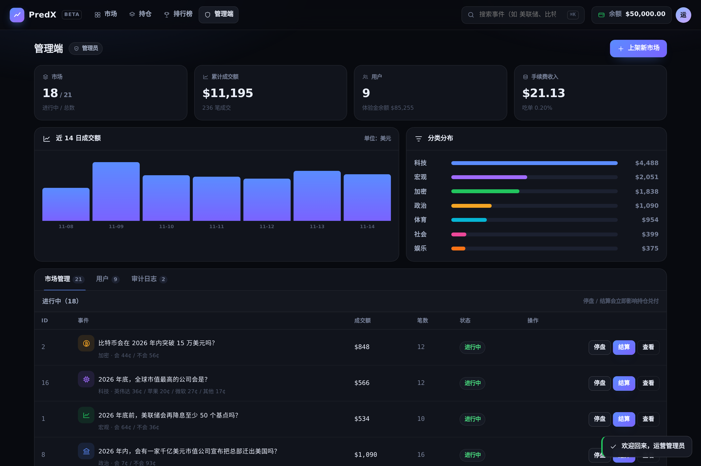

- KPI：市场（进行中/总数）、累计成交额、用户、手续费收入
- 图表：近 14 日成交额柱状图、分类成交额分布
- 页签：市场管理（停盘/复牌/结算/查看，含每个结果的最新价）/ 用户（冻结/解冻）/ 审计日志
- 右上「上架新市场」开启表单弹窗

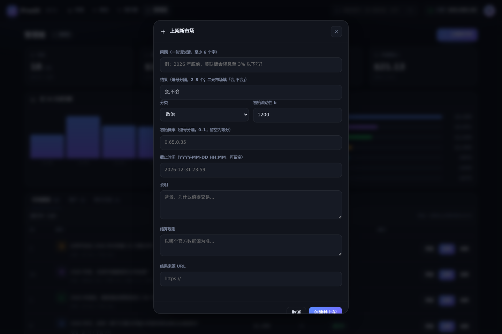

### 3.10 移动端（390×844）

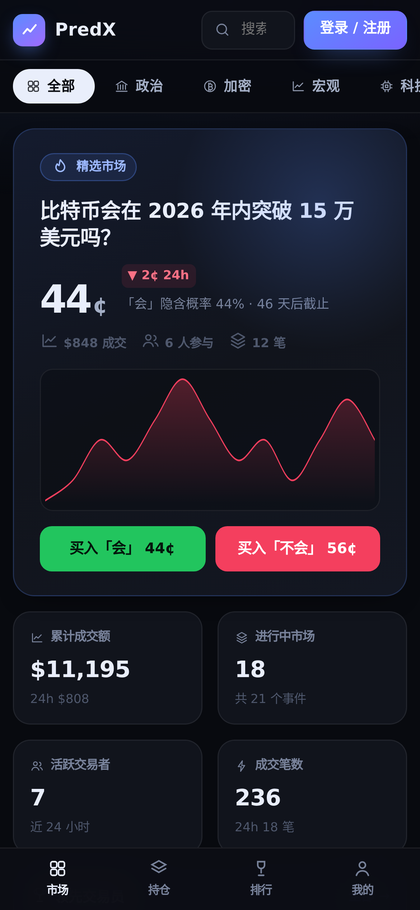

顶部只留品牌 + 搜索 + 登录；分类条可横向滑动；卡片单列；
底部固定四个 Tab（市场 / 持仓 / 排行 / 我的）。

---

## 4. 交互细节（容易被忽略但影响手感的部分）

| 细节 | 实现 |
|---|---|
| 首屏骨架屏 | 网格与 KPI 先用 `sk-card` / `sk-line` 占位，避免「白屏 → 突然出现」 |
| 悬浮反馈 | 卡片上浮 3px + 边框提亮；按钮 hover 加深；盘口档位 hover 高亮 |
| 图表读数 | 十字虚线 + 圆点 + 卡片式读数，鼠标离开淡出 |
| 快捷操作 | `⌘K`/`Ctrl+K`/`/` 聚焦搜索，`Esc` 关闭弹窗与菜单，回车提交登录 |
| 弹层规范 | 点遮罩空白处关闭；弹层内按钮不受遮罩影响（v1.0 曾因 `stopPropagation` 让所有弹窗按钮失效） |
| 提示 | 右下角 toast，成功=绿边、失败=红边、信息=蓝边，3 秒自动消失 |
| 错误处理 | 表单内联报错（红字 + 图标），接口 401 自动清 token 并提示重新登录 |
| 数字对齐 | 全局 tabular-nums，价格/金额/份数不跳动 |

---

## 5. 无障碍与工程约定

- 所有交互元素都是 `<button>` / `<a>`，有 `title` 或可见文本；图标 `aria-hidden`。
- 颜色不是唯一信息载体：涨跌同时用 ▲▼ 与正负号，盘口同时用颜色与文字「卖盘/买盘」。
- **零外链**：没有 CDN、没有字体文件、没有图片资源（图标与图表都是运行时生成的 SVG），
  内网/离线可直接跑，预览 iframe 里也不会白屏。
- 响应式断点：1180 / 980 / 720，最小支持 390px 宽。
- 前端全部在 `app/static/`（约 1.9k 行 JS + 0.6k 行 CSS），无构建步骤。

---

## 6. 与 v1.0 的界面差异（本次改动）

1. 全新设计系统：更深的底色、细描边分层、品牌渐变、统一圆角与间距
2. **去掉 emoji 图标**，改为内联 SVG 分类图标 + 语义图标库（解决内网环境方框问题）
3. 首页：Hero 精选 + 平台指标 + 领先交易员 + 三步说明 + 「关注」筛选
4. 行情图：平滑曲线、时间区间切换（1H→全部）、十字光标与悬浮读数
5. 交易面板：快捷比例、限价步进、滑点/深度提示、买卖文案与配色随状态切换
6. 详情页：状态胶囊、参与人数、同类市场推荐、页签计数
7. 持仓页：现金余额曲线、持仓分布条、页签化委托/成交
8. 排行榜：领奖台
9. 管理端：14 日成交柱状图、分类分布、三页签
10. 移动端底部导航 + 骨架屏 + toast 语义色
